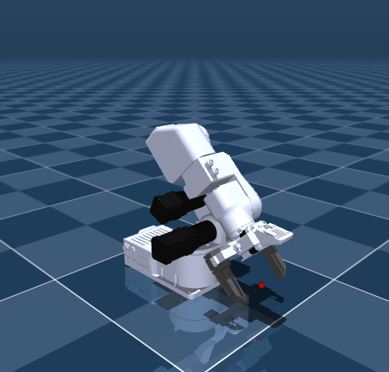

# Source Robotics PAROL6

Self-contained URDF description with the supplied PAROL6 arm geometry and the
standardized PAR6 joint convention, plus shared PAR6 end effectors.
No other checkout is needed.

Detailed notes and dimensioned drawings are in [docs/](docs/); model images are
in [previews/](previews/). Entry files, assets and ROS launch paths are unchanged.

| Tool | Model |
| --- | --- |
| Flange only | `parol6_flange.urdf` |
| MSG - Solid jaws | `parol6_msg.urdf` |
| MSG - Soft TPU jaws | `parol6_msg_tpu_glue.urdf` |
| SSG48 - Solid jaws | `parol6_ssg48.urdf` |
| SSG48 - Fin-ray jaws | `parol6_ssg48_stock.urdf` |
| Pneumatic gripper | `parol6_pneumatic.urdf` |

MSG defaults to Solid jaws; SSG48 defaults to Solid jaws. The alternative
options are MSG Soft TPU jaws and SSG48 Fin-ray jaws.
The original side-gripping pneumatic assembly is also selectable; its jaws
move symmetrically through 3.5 mm each. See [PNEUMATIC.md](docs/PNEUMATIC.md) for
the mounting reference, TCP and explicitly estimated dynamics/actuation.

Install with colcon using [the ROS 2 guide](docs/ROS2.md), then run `ros2 launch parol6_description display.launch.py end_effector:=msg`. ROS 1 retains `roslaunch parol6_description display.launch end_effector:=msg`. Other viewers can open the URDF directly.

Read [DH.md](docs/DH.md) and [the PAR6 comparison](docs/KINEMATICS_COMPARISON.md) before
exchanging joint angles with older exports. Public angles, axes and J6
orientation now match PAR6, as does the corrected 177 mm forearm (d4 = -177 mm).
Flange-ending d6 differs: -50.5 mm on PAROL6 versus -57.1 mm on PAR6.
The lower-arm visual/collision origins shift outward 0.65 mm from the old
export, and every shared tool moves 6.6 mm toward J6 to match housing spacing.
The exported L6 tool is replaced by the selected tool.
Black actuator meshes are visual-only partitions; full original arm meshes
remain the collision assets. PAR6's badge artwork is not placed on PAROL6.

Mass, local COM and central inertia are inherited from the corresponding
PAR6 package as requested, not independently measured for PAROL6. Flange mass
is 55.5 g; complete MSG is 380 g and complete SSG48 is 440 g, with 39.3 g per
moving finger/jaw/slider assembly. See [DYNAMICS.md](docs/DYNAMICS.md) for limits of
this assumption and [DYNAMICS_AUDIT.md](docs/DYNAMICS_AUDIT.md) for validation.
See [ACTUATION.md](docs/ACTUATION.md) for finite position-control settings;
open-loop hardware does not imply infinite simulated joint stiffness.
See [KINEMATIC_REVIEW.md](docs/KINEMATIC_REVIEW.md) for dimensioned model snapshots
and tool-specific DH tables for all six configurations.

The authoring repository is https://github.com/Source-Robotics/robot_descriptions.

## License and attribution

Models and assets: **CC BY 4.0**. See [attribution and license scope](docs/ATTRIBUTION.md).

[MoveIt 2 planning](docs/MOVEIT2.md): install `parol6_moveit_config` alongside this package for TCP planning and mock execution.

[Changing colors](docs/COLORS.md): shared palette, part overrides and illustrated examples.

[MSG built-in camera](docs/MSG_CAMERA.md): simulated views with both jaw options and a rendering example.
