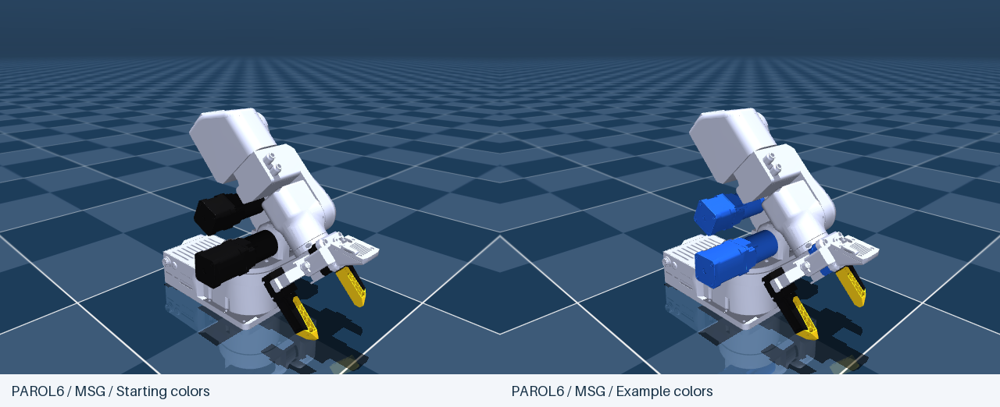
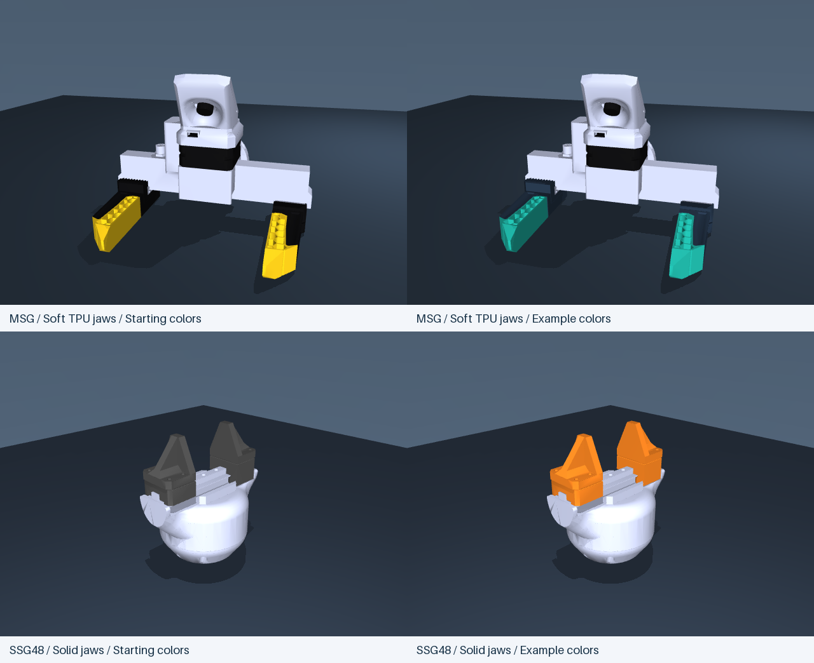
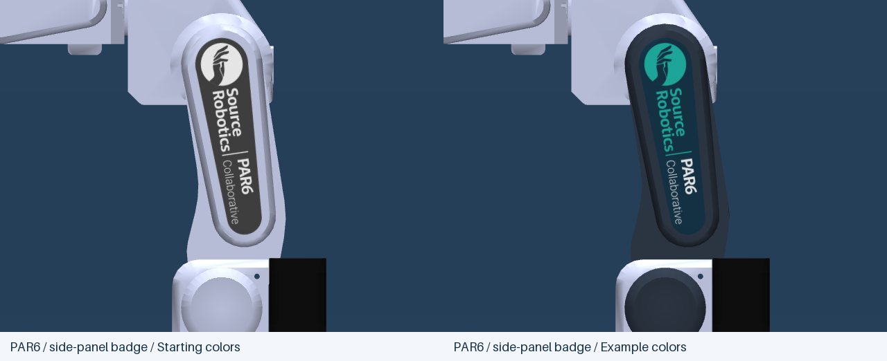

# Changing model colors

[Back to the repository](../README.md)

**Edit one file: [`source/appearance/colors.json`](https://github.com/Source-Robotics/robot_descriptions/blob/v2.18.1/source/appearance/colors.json).**
The build applies it to PAR6, PAROL6, standalone MSG and standalone SSG48, in
both URDF and MuJoCo, including every tool/jaw option and the grasp fixtures.
The starting palette keeps the existing appearance.

## Quick example

In that file, change these entries inside `colors`:

```json
"structure": "#CAD1EE",
"motors": "#2060E0",
"camera_lens": "#080808",
"msg_soft_inserts": "#FFD21A"
```

This gives both robots blue J1/J2/J3 motors and makes the MSG motor blue too.
The camera lens stays black, the structures stay light, and the Soft TPU inserts
stay yellow. Keep the other settings in the file.



The images in this guide are renders of the actual MuJoCo models. Each pair
uses the same model, pose, lighting and camera; only its example colors change.
The shared build applies the same settings to URDF. Examples are independent:
start from the default palette for each one, then change only the listed entries.

After installing the [build dependencies](https://github.com/Source-Robotics/robot_descriptions/blob/v2.18.1/docs/maintenance/BUILDING.md), run this from the
repository root:

```bash
python tools/build.py --models-only --render
```

This uses the existing CAD meshes, applies the palette, rebakes the badge,
refreshes the dimensioned review snapshots, validates the models and exports
all eight packages to `dist/`. `--render` needs working OpenGL. Normal builds
reuse the checked snapshots without OpenGL; refresh them after changing colors.
If you also changed CAD/geometry, omit `--models-only`.

Open a rebuilt model to see the result. Colors are baked into the model files
and badge texture: no extra process runs while viewing or simulating. This is
an editing convenience, not a simulation-speed optimization. It does not add
bodies, joints, geoms, triangles or higher-resolution textures, or change
kinematics, collisions, masses, COM, inertia or controller settings.

## Common colors

Each entry accepts `"#RRGGBB"` or `[red, green, blue, 1]`, with channels from
0 to 1. The alpha channel must be 1. Existing precise gray/black values use
arrays; replacing one with a HEX color is fine.

| Key inside `colors` | Parts controlled |
| --- | --- |
| `structure` | Both robot housings, MSG/SSG48 bodies, flange and the PAR6 badge's surrounding cover |
| `motors` | J1/J2/J3 motor + gearbox and the MSG motor |
| `camera_lens` | MSG lens |
| `msg_solid_jaws` | MSG Solid jaws, including the moving carriage geometry |
| `msg_soft_holders` | MSG Soft TPU black holders and carriages |
| `msg_soft_inserts` | MSG Soft TPU honeycomb inserts |
| `ssg48_solid_jaws` | SSG48 Solid jaws and carriage geometry |
| `ssg48_fin_ray_jaws` | SSG48 Fin-ray jaws and carriage geometry |
| `pneumatic_body` | Pneumatic gripper housing |
| `pneumatic_jaws` | Both pneumatic fingers |

A color applies to an existing visual partition. For example, a jaw and its
carriage cannot get separate colors if they share one visual mesh.

### Example: teal MSG inserts and orange SSG48 jaws

Change these three entries inside `colors`; keep the other entries as they are:

```json
"msg_soft_holders": "#26364A",
"msg_soft_inserts": "#20B7A8",
"ssg48_solid_jaws": "#F08020"
```



The dark blue holders and teal honeycomb inserts affect the MSG Soft TPU option.
The orange setting affects SSG48 Solid jaws. Each applies to both fingers,
standalone and arm-mounted, while the other jaw options keep their own colors.

## Override an individual part

The optional `overrides` section takes precedence over common colors. For
example, keep the common motor color black but make J1 orange and the MSG motor
blue:

```json
"overrides": {
  "j1_motor": "#F08020",
  "msg_motor": "#2060E0"
}
```

Supported keys are `j1_motor`, `j2_motor`, `j3_motor`, `msg_motor`, `msg_body`,
`ssg48_body`, `flange`, `par6_structure`, `parol6_structure` and `par6_panel`.
Remove an override to return that part to its common color. Tool colors stay
the same whether the tool is standalone or mounted on either robot.

`par6_panel` affects the textured cover surrounding the badge. Without that
override it follows `par6_structure`, which in turn follows `structure`.
Badge colors are baked into RGB pixels, so array values there are rounded to
the nearest 8-bit channel. PAROL6 retains its existing unbadged cover.

Unknown keys, duplicate keys, invalid HEX values, non-finite/out-of-range
channels and transparency are rejected before the build changes models.

## Badge artwork

The same file has a `badge` section for `background`, `emblem`, `symbol`,
`wordmark`, `robot_name`, `tagline`, `divider`. Change those colors and run
the same build command. Badge size, resolution, placement and SVG shapes stay
in [`source/artwork/par6_side_badge.json`](https://github.com/Source-Robotics/robot_descriptions/blob/v2.18.1/source/artwork/par6_side_badge.json)
and [`par6_side_badge.svg`](https://github.com/Source-Robotics/robot_descriptions/blob/v2.18.1/source/artwork/par6_side_badge.svg).

### Example: graphite cover and teal logo

Set `overrides` to the following, or add this entry to your existing overrides:

```json
"overrides": {
  "par6_panel": "#303A48"
}
```

Then set the badge section to:

```json
"badge": {
  "background": "#15364A",
  "emblem": "#20B7A8",
  "symbol": "#15364A",
  "wordmark": "#20B7A8",
  "robot_name": "#FFFFFF",
  "tagline": "#FFFFFF",
  "divider": "#20B7A8"
}
```



This changes the existing PAR6 cover and badge artwork. The logo shapes,
placement and texture resolution stay the same. PAROL6's unbadged cover is
unaffected by these PAR6-specific settings.

The color fields retained in the historical badge/jaw/pneumatic geometry
configs are baseline settings for their low-level geometry tools. The complete
build always applies `source/appearance/colors.json` afterwards; use the shared
file for maintained colors. It never rewrites those geometry configurations.

## Downloaded packages and previews

Every package includes `docs/colors.json`, a copy of the palette used when it
was built. It is a record, not a runtime configuration. To regenerate a shared
theme, use the central source checkout and the command above.

For a one-off edit without the build environment, you can still change visual
RGBA values in a downloaded URDF or MJCF. Those changes apply only to the files
you edit. For example, the retained material `j1_actuator_black` controls J1,
`msg_camera_lens_black` controls the lens, and `msg_jaw_yellow` controls the TPU
inserts. Historical material names stay unchanged when recolored. Leave hidden
collision geoms and collision/inertial/joint definitions alone. The PAR6 cover
uses an embedded texture; change its palette through the build instead.

The `--render` flag refreshes the twelve dimensioned review sheets. Other guide
screenshots are separate presentation assets. To refresh those after a theme
change, run the optional renderers and rebuild to copy them into packages:

```bash
python tools/render_parol6_previews.py
python tools/render_gripper_previews.py
python tools/render_msg_camera_previews.py
python tools/build.py --models-only
```

To regenerate the optional review PDF too, use
`python tools/build_review_sheets.py --pdf` with the review dependencies installed.

To refresh the three illustrated comparisons in this guide, run
`python tools/render_color_examples.py`, then rebuild the packages. This optional
OpenGL renderer uses temporary model copies and leaves the active palette,
runtime models and checked badge texture unchanged. The exact settings and
viewing poses are recorded in the [render manifest](../previews/color_examples/render_manifest.json).
