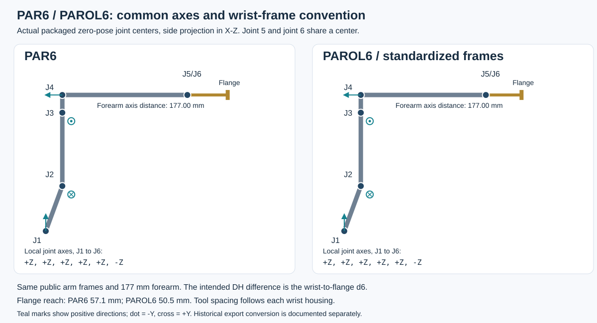

# PAR6 and PAROL6: common DH and joint convention

The generated PAROL6 packages now use **PAR6 joint directions and origin
orientations, including J6**, per user instruction. Public package angles
are shared: `q_PAROL6 = q_PAR6`. Both use the corrected **177 mm forearm**.
The intended difference in the flange-ending standard DH tables is now
**d6**, reflecting the shorter PAROL6 wrist housing.



## Standard DH table

`A_i = Rz(theta_i) Tz(d_i) Tx(a_i) Rx(alpha_i)`; endpoint is the common
physical flange. Distances are millimetres; alpha is displayed in degrees.
Theta expressions use radians, with `q` the package angles in radians.

| Joint | theta, both robots | alpha, both | a, both | PAR6 d | PAROL6 d |
| ---: | --- | ---: | ---: | ---: | ---: |
| 1 | `q1` | -90 | 23.420721 | 110.5 | 110.5 |
| 2 | `q2 - pi/2` | 180 | 180 | 0 | 0 |
| 3 | `q3 + pi` | 90 | -43.5 | 0 | 0 |
| 4 | `q4` | -90 | 0 | -177.00 | -177.00 |
| 5 | `q5` | 90 | 0 | 0 | 0 |
| 6 | `q6 + pi` | 180 | 0 | **-57.1** | **-50.5** |

## Geometry corrections and mounting clearance

The user corrected PAROL6's forearm from the historical export's 176.35 mm
to 177.00 mm. Its J5 origin is now `(0, 0, -0.177)` m relative to wrist_1_link.
The lower-arm visual and collision origins both move `(0, 0, -0.00065)` m
in that same frame, keeping the housing geometry aligned with the wrist.
The original STL records are preserved; no vertices were stretched.

The included wrist housing surfaces end at +41.1 mm (PAR6) and +34.5 mm
(PAROL6), measured along local +Y of wrist_2_link, which follows J6's
forward axis. These are the largest connected housing components; internal
motor/shaft components do not define the housing mounting face.
Keeping PAR6's approximately 1 mm housing-to-flange rear-face clearance gives:

`PAROL6 flange reach = 57.1 + (34.5 - 41.1) = 50.5 mm`.

This is a CAD-derived spacing match requested by the user, not an independent
hardware measurement. The entire flange subtree moves 6.6 mm toward J6.
Every flange-relative tool, camera, finger, collision, inertial and TCP
transform stays unchanged. Tool meshes retain their original part coordinates.
Gripper TCP axial reach is consequently 134.3 mm on PAROL6 versus 140.9 mm
on PAR6; the MSG lateral TCP offset remains 28.35 mm on both.

The shorter tool lever arm affects generalized dynamics even with inherited
local mass/COM/inertia values. These values and finite actuator settings were
not retuned or re-estimated by the geometry correction.
The existing RCB reference rounds the shoulder offset to 23.420 mm; both CAD
descriptions use 23.420721 mm. This is a reference-data precision difference,
not a PAR6/PAROL6 geometry difference.

## Matching public frames

Both models use `base_joint`, `shoulder_joint`, `elbow_joint`,
`wrist_1_joint`, `wrist_2_joint`, `wrist_3_joint`, in that order. Local axes
are `+Z, +Z, +Z, +Z, +Z, -Z`. J6's URDF origin RPY is `(pi/2, 0, pi)`
in both models; each native model inherits the same PAR6 quaternion.
The wrist_3_link-to-flange transform has identity rotation and local XYZ
`(0, 0, +0.0571)` m on PAR6, `(0, 0, +0.0505)` m on PAROL6.
All flange-relative tools, cameras,
finger coupling, contacts and TCP definitions are unchanged.

Source PAROL6 joint types/physical bounds are retained with bounds converted
to the normalized coordinates; for example old L3 `[-2, 1.3]` becomes
elbow_joint `[-1.3, 2]`. The first five joints remain revolute and J6 remains
continuous. Existing PAR6 packages use continuous arm joints. Joint types,
limits, arm meshes and actuation assumptions are separate from a DH table.

## Historical export conversion

The original supplied SolidWorks export remains byte-for-byte preserved at
`source/parol6/original/` in the authoring repository. It is not the public
angle convention of the generated packages. To compare its old coordinates:

```text
q_source_L1_to_L6 = [q1, q2, -q3, -q4, -q5, -q6]
```

Old L1-L6 names map in order to the six descriptive link/joint names. L1-L5
CAD part coordinates still hold the corresponding meshes and local inertias.
Old L6 is rotated by 180 degrees about local Y relative to normalized
wrist_3_link; its old end-tool mesh is retained as source only and replaced
by the selected shared tool. This frame change therefore requires no rotation
of the shared tools' own meshes or inertias. Source four-decimal RPY values
are replaced in generated joints by the PAR6 reference orientations.

The axis standardization replaced the earlier 2.9.0 package convention. Consumers
of that local version must apply the historical sign conversion once when
migrating saved joint-angle trajectories. New PAR6/PAROL6 trajectories share
coordinates directly. The existing PAR6 DH/hardware convention remains
`TH = q + [0, -pi/2, pi, 0, 0, pi]`. An export or standardized model does
not independently verify a physical PAROL6 controller's encoder/homing mapping.

## Verification

Every profile was checked at 160 configurations.
The maximum residual
against matching PAR6 frames is **5.05e-12 mm /
0 degrees**. At the same public angles the physical flange
differs by at most **6.600000 mm /
0 degrees**. The expected translation magnitude is 6.6 mm
along the wrist's local axial direction; an explicit vector check verifies it.

After applying the intentional +0.65 mm forearm correction to the sign-mapped
historical export, its arm comparison is within
**0.001714 mm / 0.000880 degrees**; the residue comes
from replacing its rounded joint-origin angles with the PAR6 orientations.
The raw historical-source discrepancy is recorded separately in the JSON.
Native/URDF TCP agreement is within **0.002474 mm /
0.000932 degrees**. Maximum ideal-DH approximation error across
both formats is **0.002357 mm / 0.000932 degrees**; the existing
PAR6 native quaternion precision is inherited, and its URDF uses full precision.

Mass/COM/central inertia, native armature and complete native tool subtrees
are checked against PAR6 for all six profiles. Original arm collision meshes
and visual triangle records are preserved. Available tools: flange; MSG Solid
jaws (default) or Soft TPU jaws; SSG48 Solid jaws (default) or Fin-ray jaws;
and the original side-gripping pneumatic assembly. The pneumatic jaws use
coupled 3.5 mm slides; its legacy 195 g total and CAD-derived mass distribution
are unverified estimates. Its operational TCP has 45.25 mm lateral offset and
68.9 / 62.3 mm axial reach on PAR6 / PAROL6. See `PNEUMATIC.md`.

The shorter PAROL6 flange reference is derived from the supplied housing
geometry. The original export has no independently named flange marker.
See `DYNAMICS.md`, `DYNAMICS_AUDIT.md`, and `ACTUATION.md` for inherited physical
data, finite servo settings and calibration limits. Machine-readable results:
`reports/kinematics/parol6_validation.json` in the authoring repository.
