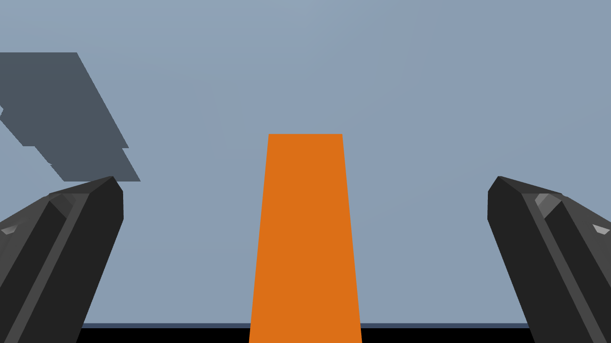
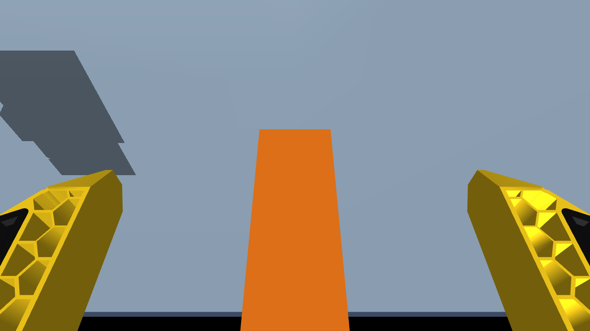

# View from the MSG built-in camera

[Back to the model instructions](../README.md)

These are **simulated images from the model's actual named `msg_camera`**,
with Solid and Soft TPU jaws fully open. The orange object and table come from
the existing 50 g box grasp-test scenes. The camera position, orientation,
field of view, object placement and jaw geometry are retained. Demo headlight
brightness is increased to make the dark parts readable; no crop, image rotation
or alternate viewpoint is applied.

| Solid jaws | Soft TPU jaws |
| --- | --- |
|  |  |

The jaws occupy the lower sides of the image and the object is in the grasp
area between them. Parts of this close object extend beyond the image border.
An empty scene shows the jaws and background instead; the orange box is a
simulation fixture, not an object included with the standalone gripper model.

## Current camera definition

| Property | Value |
| --- | --- |
| MuJoCo camera | `msg_camera`, fixed to `msg_gripper_link` |
| Requested image size | 1280 x 720 pixels |
| Vertical field of view | 51.5 degrees |
| Jaw configurations | MSG Solid jaws and MSG Soft TPU jaws |
| Robot configurations | MSG alone, or MSG mounted on PAR6/PAROL6 |
| URDF frames | `msg_camera_link` and `msg_camera_optical_frame` |

The flange-relative camera mounting is shared by the standalone and mounted
MSG variants. Moving the robot changes its view of the world. URDF supplies
the mounting/optical frames; a consuming simulator must provide its camera
sensor/rendering configuration. These previews are rendered with native MuJoCo.

**These are not photographs or a calibrated hardware feed.** Compare with the
real MSG camera before using the pose/FOV for vision calibration. Real lens
distortion, exposure and image processing are not represented by these renders.
The old PAR6 appearance notes mentioned 90 degrees; the current MJCF actually
specifies **51.5 degrees vertically**, as used here.

## Render the camera in your own scene

The camera already exists in MSG model files. From an extracted MSG MuJoCo package,
this Python example saves its current view (MuJoCo and Pillow required):

```python
import mujoco
from PIL import Image

model = mujoco.MjModel.from_xml_path("scene_solid.xml")
model.vis.global_.offwidth = 1280
model.vis.global_.offheight = 720
data = mujoco.MjData(model)
mujoco.mj_forward(model, data)
options = mujoco.MjvOption()
options.sitegroup[:] = 0  # Hide TCP/helper markers in the image.

with mujoco.Renderer(model, height=720, width=1280) as renderer:
    renderer.update_scene(data, camera="msg_camera", scene_option=options)
    Image.fromarray(renderer.render()).save("previews/msg_camera.png")
```

Use `scene_soft_tpu.xml` for the other jaws, or the appropriate arm
`scene_msg*.xml` for a mounted camera. The standalone viewer scene does not
contain a grasp object, so its background differs from the examples above.
No camera needs to be added to the model to render this view.

## Refresh the documented examples

From the authoring repository with its build dependencies and working OpenGL:

```bash
python tools/render_msg_camera_previews.py
```

This uses `mujoco/par6/bench/msg-solid_box.xml` and
`msg-soft-tpu_box.xml`. PNGs and their camera/render records are written under
`docs/images/`. The normal headless build copies the committed images and this
page into the six arm/MSG packages; standalone SSG48 packages have no camera.
Refresh the examples explicitly after changing camera settings or jaw visuals.
